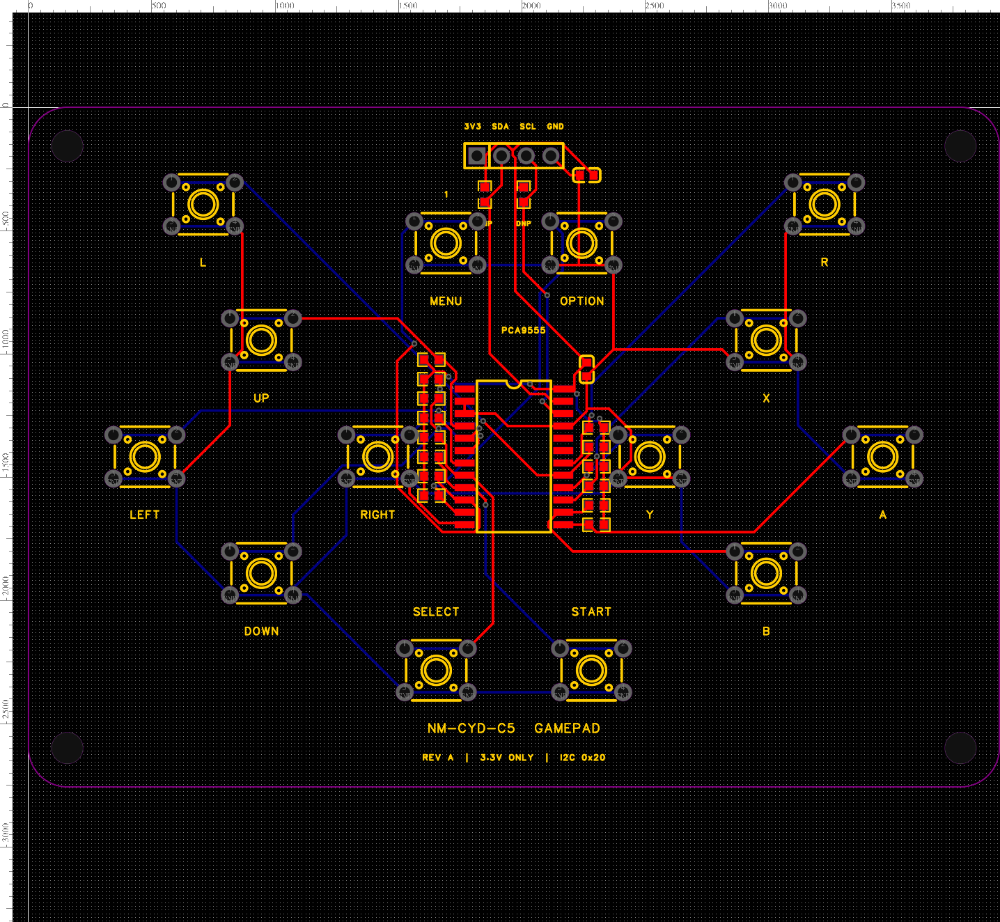

# NM-CYD-C5 separate button controller — Rev A

A 100 × 70 mm, two-layer controller PCB with 14 buttons, connected to the NM-CYD-C5 by four wires. Designed in EasyEDA on 29 October 2026; the outline was reshaped on 30 October 2026 into a **SNES-style dog bone**: full-height rounded wings at both ends with a scooped waist across the middle, 7 mm corner radii, a 3 mm scoop along the top centre and an 8.2 mm scoop along the bottom centre. The button positions, mounting holes, routing, and electrical circuit are unchanged — only the board edge was cut.

**The existing Retro-Go firmware and flash image were left unchanged. Continue using the touchscreen for now. This PCB needs a later I²C input-driver configuration before its buttons can control Retro-Go.** It is a prototype design checked in CAD; no assembled controller has been tested yet.

## Files and opening the project

- `easyeda/NM-CYD-C5-Gamepad-RevA.epro2`: standalone editable EasyEDA project, including schematic, footprints, symbols, and routed PCB.
- `manufacturing/NM-CYD-C5-Gamepad-RevA-Gerbers.zip`: copper, solder mask, silkscreen, board outline, and complete plated/non-plated drill files.
- `manufacturing/JLCPCB-NM-CYD-C5-Gamepad-RevA-R4.zip`: the same verified Gerbers with a clear JLCPCB upload filename. Follow [`JLCPCB-QUOTE.md`](manufacturing/JLCPCB-QUOTE.md) for quote settings.
- `manufacturing/assembly/JLCPCB-NM-CYD-C5-RevA-R4-CPL.csv` and the matching `-BOM.csv`: files for top-side factory assembly of all 32 fitted components. Follow the [assembly upload guide](manufacturing/assembly/ASSEMBLY.md); R15/R16 are omitted.
- `manufacturing/assembly/JLCPCB-NM-CYD-C5-RevA-R4-PCBA-Gerbers.zip`: use this Gerber ZIP for assembly service. It adds the top paste layer for the fitted SMT parts to the same verified PCB/drill data, with R15/R16 paste openings omitted.
- `BOM.csv`: parts to fit and the two optional resistors to leave unpopulated.
- `assembly-positions.csv`: component centers and rotations, viewed from the top; origin at the upper-left corner.
- `button-map.csv`: every button, expander pin, and input bit.
- `preview/schematic.webp`: schematic preview. The editable schematic is in the project.
- `reports/validation.json`: electrical, manufacturing, and firmware-preservation checks.

In EasyEDA, use **File → Import → Professional** to import the `.epro2` file as a new local project. Open **Controller Rev A → Schematic1 → P1** or **PCB1**. The archive is the deliverable; the raw `.esch`, `.epcb`, and `.net` files are supplementary sources. Do not order a board from the preview image.

## Circuit and physical layout

The PCA9555D expander reads each button independently. Each input has a 10 kΩ pull-up to 3.3 V, and pressing its switch connects it to ground. There is no switch matrix, so direction/action combinations do not create matrix ghosting. Software must still debounce the contacts and interpret the combinations.

The layout has a D-pad on the left; X/A/B/Y in a diamond on the right; L/R at the upper corners; Menu/Option at the top center; Select/Start at the bottom center. These are individual 6 × 6 mm tactile switches, including the D-pad directions. A shared rocking D-pad or enclosure would be a separate mechanical design.

U1 is **PCA9555D,112, SO24**. Use the matching SO24 package; the DB/PW/QFN versions do not fit this footprint. A0, A1, and A2 connect to ground, giving the 7-bit I²C address **0x20**. INT is unused because the intended driver polls the inputs. IO1_6 and IO1_7 are unused. C1 and C2 are 100 nF ceramic capacitors.

The [NXP datasheet](https://www.nxp.com/docs/en/data-sheet/PCA9555.pdf) is the reference for the pinout, register map, address, and SO24 package. The [Omron B3F datasheet](https://omronfs.omron.com/en_US/ecb/products/pdf/en-b3f.pdf) defines the switch dimensions and internally connected pairs: terminals 1–2 are one contact, and 3–4 are the other.

## Connect the cable

**Use the NM-CYD-C5 connector labeled CN1.** Its documented pin order is 3.3 V, IO9, IO8, GND. The board's P1 connector has a different pinout and includes the audio GPIO26. See the [manufacturer's CN1 pinout](https://wiki.rockbaseiot.com/docs/products/nm-cyd-c5/#i2c-connector-cn1).

| Controller J1 pin | Printed label | NM-CYD-C5 CN1 pin | Host signal |
|---|---|---|---|
| 1, square pad | 3V3 | 1 | 3.3 V |
| 2 | SDA | 2 | GPIO9 |
| 3 | SCL | 3 | GPIO8 |
| 4 | GND | 4 | Ground |

J1 is a **2.54 mm, 1 × 4 male header**. Viewed from the controller's component side, with the title at the bottom, its pins run left to right as printed above. Pin 1 is the square copper pad; the nearby `1` mark also identifies it.

The host connector's mating housing, pitch, and pin-facing orientation have **not** been measured on your physical board. Select the cable's host plug after checking CN1; the controller header is not a claim of direct mechanical compatibility with that socket. Identify the signals by labels and continuity, not by cable colors or by assuming both connector faces have the same left-to-right order. Keep the first cable about 15 cm or shorter.

Power off before connecting. Use 3.3 V throughout, with a common ground. Supply the controller from CN1; do not simultaneously power it from a second supply. Check that the connector is not reversed before applying power. GPIO26/SPEAK_IN, the SC8002B audio circuit, the display, and the SD-card SPI wiring are not used by this controller.

**Leave R15 and R16 unpopulated (DNP)** when connected to the NM-CYD-C5: its IO8/IO9 already have pull-ups through R32/R33, as documented by the manufacturer. R15/R16 provide optional 10 kΩ pull-ups for a standalone bench setup without bus pull-ups. They are different from the fourteen button pull-ups R1–R14, which must be fitted.

## Assembly and PCB order

Specify a two-layer FR-4 board, **100 × 70 mm, 1.6 mm thickness, with 7 mm radius corners and a scooped waist**, with plated through holes, solder mask on both sides, and top silkscreen. The outline still fits the original 100 × 70 mm envelope and is built from straight runs and tangent circular arcs only (12 arcs, 8 lines, no Bezier curves), so every fabricator can cut it directly. The wings at each end stay the full 70 mm tall; the waist between them is 58.8 mm tall, scooped 3 mm along the top edge (x 28–72 mm) and 8.2 mm along the bottom edge (x 28–72 mm). The closest copper — the +3V3 run from J1 pin 1 — stays 0.57 mm inside the new edge, and DRC passes with no errors.

The four mounting holes are still 3.2 mm diameter at (4,4), (96,4), (4,66), and (96,66) mm. Because 7 mm corner radii replace the earlier 4 mm ones, the hole edge now sits **1.16 mm** from the closest board edge instead of 2.4 mm. Check washer/screw-head overhang against that web before ordering: 7 mm is the largest corner radius that keeps all four 3.2 mm holes fully on the board, so a bigger radius means moving holes. The holes mount this separate controller; they do not match mounting holes on the display board.

The routing uses 0.254 mm tracks and 0.305 mm via drills. Switch/header drills are 1.1 mm. The switch hole centers form a 6.5 × 4.5 mm rectangle. Inspect a 1:1 print or the CAD footprint against the actual switches before ordering a batch. The Gerber archive contains the full PTH drill file; an additional via-only drill file is unnecessary and has been excluded from that archive.

Fit U1, R1–R14, C1/C2, J1, and SW1–SW14. Leave R15/R16 empty. U1's notch faces the cable header; pin 1 is the upper-left lead in the top view. The capacitors are nonpolar. Resistor positions are listed individually in `assembly-positions.csv`; R1–R8 form the left center bank, R9–R14 the right center bank. All buttons use the same Omron B3F-1000 footprint. Buy switches with that exact pin geometry; other 6 mm switch families can have different lead spacing.

## Verify the assembled prototype

1. With power disconnected, inspect solder joints and check that 3V3 and GND are not shorted. Confirm the cable pinout end to end.
2. Check that each switch closes only its intended contact pair. A four-leg tactile switch has two internally connected pairs; pressing it joins the pairs.
3. For a bench test, use a 3.3 V I²C master with suitable pull-ups. Keep the NM-CYD-C5 disconnected during this separate test. Confirm an ACK at 7-bit address `0x20`.
4. Configure registers `0x06` and `0x07` to `0xFF` (inputs), and `0x04`/`0x05` to `0x00` (normal polarity). Read input registers `0x00` and `0x01`. For each read, the lower fourteen bits should be high when released; pressing a button clears its assigned bit. Ignore the two unused high bits.
5. Test every button, diagonal directions, and direction plus two action buttons. Check against `button-map.csv`. A later driver should sample periodically and debounce for roughly 15–20 ms; polling can be tuned during game testing.

These assembly checks remain to be performed on real hardware. CAD DRC does not verify soldering, the host cable, ergonomics, or game behavior.

## Controls and ROM compatibility

This design supplies the digital controls used by the emulators in this checkout. It does not add an emulator, improve a game's emulation accuracy, or guarantee that every ROM runs. No ROM files are included. Existing ROMs stay on the SD card under `/roms/<system>/`, for example `/roms/doom/`.

| System in this build | Hardware coverage and existing software behavior |
|---|---|
| NES, GB/GBC, SMS, Game Gear, PC Engine | D-pad, A/B, Start/Select, plus Menu/Option for the Retro-Go UI. Some systems use different names or swap action-button meanings. |
| Genesis / Mega Drive | The current gwenesis front end uses A, B, **Select as C**, and Start. It implements the three-button mapping; the extra physical X/Y/L/R buttons do not create six-button emulation. |
| SNES | The PCB has all twelve console controls. The current front end does **not** directly use Retro-Go X/Y/L/R. Its Type A map uses Start/Select as X/Y and Menu combinations for L/R and console Start/Select. A later mapping change is required for the printed dedicated controls to match SNES directly. Type B rearranges the actions; Type C omits X/Y/L/R. |
| Lynx, Game & Watch | The available digital buttons cover the existing front-end inputs; behavior remains game dependent. |
| MSX / ColecoVision | Joystick actions are covered. Games needing keyboard or numeric keypad input still need the existing virtual controls or a later additional mapping. |
| DOOM | D-pad for move/turn; A fire/confirm, B run/strafe/back, Start use, Select weapon selection, Menu escape, Option map according to the existing front end. Multiple physical inputs are available for the combinations it reads. |

The mapping review is based on the source in this checkout, including `retro-core/main/main_snes.c`, `gwenesis/main/main.c`, the other `retro-core/main` front ends, `fmsx`, and `prboom-go`. The GPIO hardware was not tested with ROMs because firmware changes were explicitly deferred.

## Later firmware step — not performed

The controller is electrically intended for SDA=GPIO9, SCL=GPIO8, address `0x20`, active-low bits 0–13 in the order shown in `button-map.csv`. Bits match the current `RG_KEY_*` bit order: Up, Right, Down, Left, Select, Start, Menu, Option, A, B, X, Y, L, R.

Retro-Go's existing `RG_I2C_GPIO_DRIVER == 2` path is labeled PCF9539, but its input/output/direction register addresses match the PCA9555 registers used here. That is a starting point for a future implementation, not a claim that the current target already enables it. That step must configure the I²C pins/address, add the 14 active-low mappings, retain touch input, validate both input-port reads and debounce, and update per-emulator mappings where needed, especially SNES. Start bench testing at 100 kHz if needed; the existing generic I²C code currently selects 400 kHz and would need review for that change.

Only after that implementation should the five applications be rebuilt and the board reflashed. The existing user-wide ESP-IDF build/flash setup is documented in [`docs/NM-CYD-C5.md`](../../docs/NM-CYD-C5.md). No rebuild or flash was performed as part of this PCB design.

## Validation performed

EasyEDA routed all **18 nets**. Final strict electrical DRC returned **true**, with an empty error list. The schematic and PCB connection assignments were compared against the expected pin map, and all **117 connected pins** matched. The two unused input pins and INT remain unconnected. Exported outline and drill dimensions were checked. The schematic reflow preserved its netlist.

The CAD previews were visually inspected and the printed button labels adjusted. The 30 October corner update changed only the board-outline primitive; its Gerber contains four clockwise R4 quarter-arcs. Copper, mask, silkscreen, and drill geometries match the previous design. All files outside this hardware folder were compared with the baseline taken at the start of the update; the verification report records the result. The next practical checks are the physical host-connector fit and an assembled prototype, followed by the separately deferred firmware integration.
